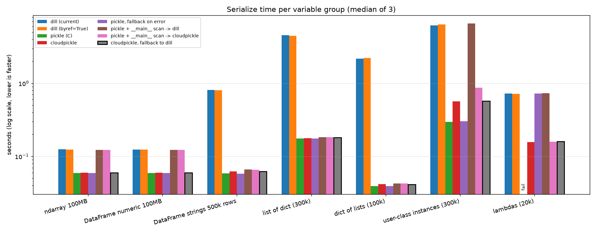
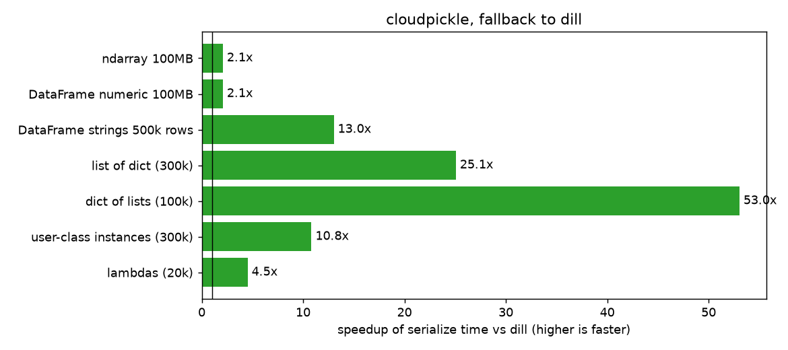
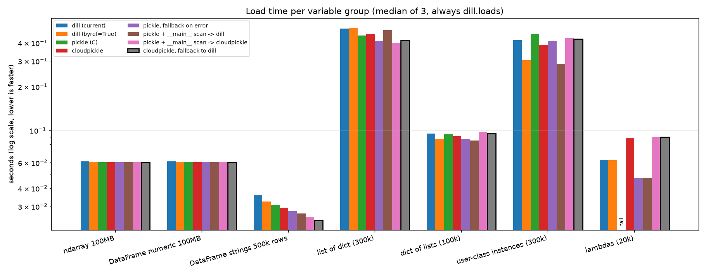
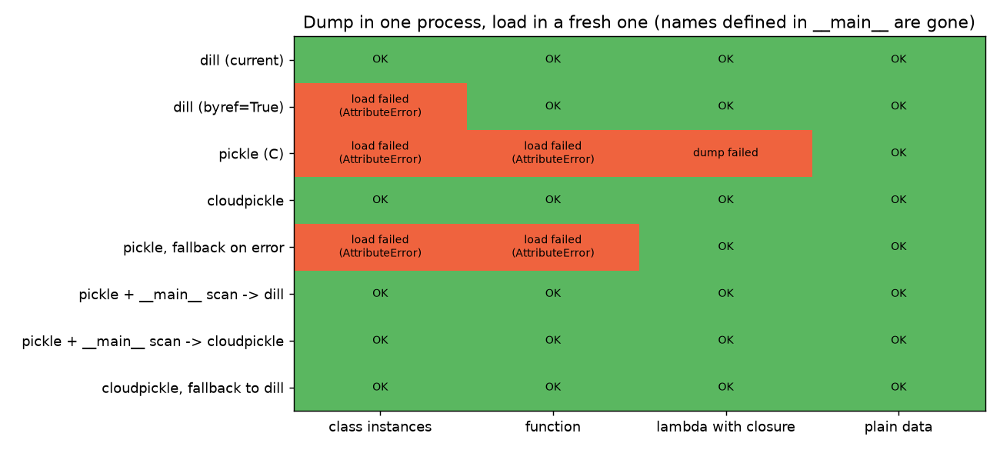

# Serializer benchmark

Compares ways to serialize one variable group (what `migrate.py` writes per group) and checks
that each result can be restored in a fresh process. Environment: Python 3.11, dill 0.4.0,
cloudpickle 3.1.2, local disk, serialization to bytes (file I/O is the same for all candidates
and left out). Median of 3 runs.

```sh
uv run --no-project --with dill --with cloudpickle --with numpy --with pandas --with matplotlib bash -c '
  python bench.py                               # -> results.json
  python restore_write.py /tmp/rc && python restore_read.py /tmp/rc   # -> restore_results.json
  python plot.py                                # -> *.png
'
```

## Serialize time



Chosen: `cloudpickle, fallback to dill` (black outline). Speedup over the current dill:



| workload | dill | chosen | speedup |
|---|---|---|---|
| ndarray 100 MB | 0.125 s | 0.060 s | 2.1x |
| DataFrame numeric 100 MB | 0.124 s | 0.060 s | 2.1x |
| DataFrame strings 500k rows | 0.807 s | 0.062 s | 13.0x |
| list of dict (300k) | 4.563 s | 0.182 s | 25.1x |
| dict of lists (100k) | 2.182 s | 0.041 s | 53.0x |
| user-class instances (300k) | 6.214 s | 0.574 s | 10.8x |
| lambdas (20k) | 0.724 s | 0.160 s | 4.5x |

## Load time

Loading always goes through `dill.loads` (cloudpickle's output is a normal pickle stream).
Load time is unchanged within noise.



## Can it be restored in a fresh kernel?

Why not plain pickle: classes and functions defined in the notebook live in `__main__`.
pickle stores them by name. The dump succeeds, the load in a new process fails.
`dill (byref=True)` has the same problem, and "pickle, fallback on error" never falls back
because the dump does not raise.


